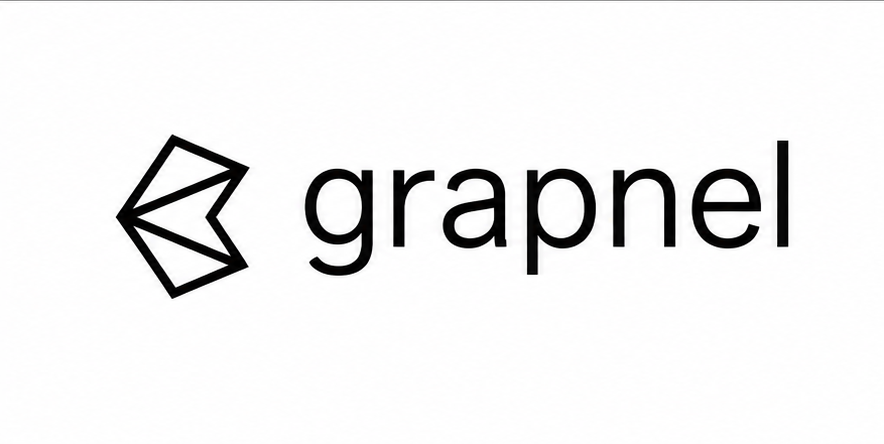

Grapnel is a **Stellar Testnet B2B infrastructure API** with a business dashboard and a separate sample fintech frontend/backend. Businesses enable modules and keep their API key on their server; customers separately authorize wallet spending through Privy.

**Implementation exists; the full onchain MVP is incomplete.** Gate 0 is committed. Local API auth, entitlement changes, key lifecycle, durable operations, three application implementations, and live provider reads are implemented. Privy-signed customer payment, treasury grant/return, Soroswap swap, Blend supply/withdraw, public app deployment and qualifying video are not yet verified. See [gate status](docs/15_GATE_STATUS.md) and [evidence](evidence/testnet.json). No production financial service, fiat rails, mainnet writes or custom Grapnel contracts.

Public source: [mthavarajah/grapnel-stellar](https://github.com/mthavarajah/grapnel-stellar). Local verification: [test/build results](evidence/local-verification.json).

## Run locally

Prerequisites: Node **22.12+**, pnpm **10.11**, PostgreSQL **16+**. The API refuses implicit or non-Testnet network settings.

```sh
pnpm install --frozen-lockfile
cp .env.example .env
# Set DATABASE_URL, ADMIN_LOGIN_SECRET (16+ random characters), SESSION_SECRET (32+).
# Keep .env ignored; use dedicated Testnet provider credentials only.
pnpm db:migrate
pnpm db:seed
cp apps/dashboard/.env.example apps/dashboard/.env.local
cp apps/fintech-demo/.env.example apps/fintech-demo/.env.local
```

Run each service in its own terminal:

```sh
pnpm dev:api        # http://localhost:3001 — /health, /docs, /openapi.json
pnpm dev:dashboard  # http://localhost:3000
pnpm dev:fintech    # http://localhost:3002
pnpm --filter @grapnel/api worker
```

Sign into the dashboard with the configured owner secret. Enable Wallets before other modules, issue a business key once, and put it **only** in the sample fintech's server `GRAPNEL_API_KEY` environment. Set `GRAPNEL_API_URL`, `PRIVY_APP_ID`, `PRIVY_APP_SECRET`, `NEXT_PUBLIC_PRIVY_APP_ID` and a random 32+ character `FINTECH_SESSION_SECRET` in its ignored server environment. Configure the same Privy app and allowed origins. No customer login bypass is provided when Privy is unavailable.

API server variables and names are in [.env.example](.env.example). Dashboard and fintech have independent templates. Never place the business key, Privy secret or treasury secret in a `NEXT_PUBLIC_` variable. App-specific environment files are server configuration; the sample browser only uses the public Privy app ID.

## Modules and authorization

Capital: `capital.wallets`, `capital.testnet_funding`, `capital.lending`. Trade: `trade.spot`, `trade.stocks`, `trade.perps`, `trade.commodities`.

Owner cookies and CSRF protect dashboard administration. A hashed/revocable API key identifies the business; its scopes follow current entitlement records on every request. Customer wallet actions additionally require verified Privy identity, current wallet ownership, exact signed transaction and a one-use authorization token. Tenant-scoped Postgres constraints, idempotency, reservations and durable worker records protect state.

```sh
curl http://localhost:3001/health
# Set GRAPNEL_API_KEY in your shell without placing it in source/history.
curl -H "Authorization: Bearer $GRAPNEL_API_KEY" \
  http://localhost:3001/v1/capabilities
```

Module administration uses an owner session: `POST /v1/dashboard/login`, then the cookie and returned CSRF token for `PATCH /v1/dashboard/modules`. See the dashboard, [REST contract](docs/03_API.md), [OpenAPI](openapi/grapnel.yaml), and [frozen integration rules](docs/14_GATE0_FREEZE.md). Existing keys gain/lose entitlements without rotation.

Financial operations return `202` and require polling. The worker stores hash/envelope before sending and reconciles chain result plus relevant effects before completion. It polls the same hash through indexing delays and never blindly creates a replacement transfer.

## Real evidence and limits

A dedicated Testnet treasury was activated with Friendbot, with **10,000 native XLM** independently read at activation. [Confirmed activation transaction](https://stellar.expert/explorer/testnet/tx/f89109f4379358f0e11771eef6e3aa7e9797dd9b99bf5c576ad3a61d37f76a36). This is **treasury activation only**, not a Privy-signed customer payment or grant/return proof.

Live Blend pool/reserve reads and a **read-only** 1 XLM collateral supply simulation succeeded. No supply transaction was signed or broadcast. The existing Blend pool and token contracts belong to Blend. Current exact asset identities and timestamped reads are preserved in [Blend research](apps/api/src/adapters/blend/research/testnet-read.json). Its current USDC reserve is a classic issuer asset exposed through a SAC; it is distinct from native XLM and is not held by this treasury merely because the symbol is USDC.

Authenticated Soroswap Testnet protocol/pool discovery and exact XLM→USDC quotes now succeed. Swap build requires a separately approved customer USDC trustline (`428 CREATE_TRUSTLINE`); no swap or fill exists. The default asset list is explicitly mainnet and is rejected. See [sanitized discovery](apps/api/src/adapters/soroswap/research/README.md). Default markets stay empty and writes return structured unavailable errors. Stocks, commodities and perps remain discovery-only, with no invented shares, balances or positions and no geographic restriction bypass.

The restricted `/v1/capital/wallets/:id/test-payment` endpoint prepares a customer-authorized payment of at most 1 XLM to the fixed treasury for Gate 1. This signing spike may run before provider execution gates. Funding/return/provider writes stay gated until independently verified Gate 1 evidence is recorded. A narrow native-XLM Blend supply inspector and enforce-mode simulation are implemented, with gated submission and observed position/wallet reconciliation. Actual signed execution remains unproven; withdrawal inspection and Soroswap route inspection still require provider/customer acceptance. No Freighter fallback has been used.

## Validation and deployment

```sh
pnpm lint
pnpm typecheck
pnpm test                         # offline tests; no chain broadcasts
API_TEST_DATABASE_URL=postgres://localhost/grapnel_api_test pnpm test:integration
pnpm build
pnpm test:e2e                     # local apps running; installed Chrome or Playwright Chromium
pnpm smoke:testnet               # read-only verification, never signs or sends
pnpm exec tsx scripts/scan-secrets.ts
```

Integration tests require a disposable database whose name ends in `_test`; they must never target development/production data. See [deployment guide](deploy/README.md), [submission script](deploy/SUBMISSION_SCRIPT.md), [source review](docs/13_SOURCES.md) and [agent handoffs](docs/handoffs/). Public URLs and demo/video links remain null until actually deployed and checked. Local screenshots are labeled local.

The [official deadline](https://blockchain-stellar-ic.devpost.com/details/dates) was rechecked November 10: **November 13, 2026 at 08:30 EST**. Submission requires public source, a functional Testnet prototype URL and/or owned contract IDs, a public one-minute functioning demo video, pitch and trifold. Missing Gate 2 transactions must be disclosed as an incomplete full MVP.
